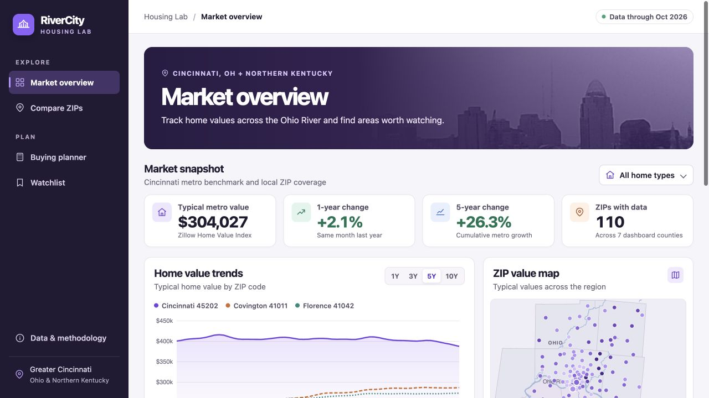

# RiverCity Housing Lab

[Open the live dashboard](https://mayursharma12.github.io/real-estate/)

A browser-based housing market dashboard and home-buying planner for Greater Cincinnati and Northern Kentucky. Use it to compare ZIPs on both sides of the Ohio River and test a purchase budget three to five years out.

The October 2026 snapshot includes 110 ZIP codes and monthly home-value history back to January 2016.



## Try it in one minute

1. Compare Covington (41011) and Florence (41042) under **Market overview**. Switch from single-family homes to condos and co-ops to see how values differ by property type.
2. Open **Buying planner** for one ZIP and choose a four-year timeline.
3. Increase the mortgage rate by one percentage point and see how the monthly payment changes. Use the savings target to see how much to set aside each month under those assumptions.

## Use the dashboard

1. Select all homes, single-family homes, or condos and co-ops in **Market overview**.
2. Compare up to four ZIPs on the historical chart. Use the map or **Compare ZIPs** to find areas. Filter the explorer by region and current home value, then export the filtered monthly observations.
3. Save ZIPs to the browser-local **Watchlist**. Use a row’s calculator button to open that ZIP in **Buying planner**.
4. Choose a purchase horizon and enter your assumptions. The planner shows scenario price, estimated monthly payment, cash required, savings per month, and sensitivity to the mortgage rate.

## Run locally

Open `docs/index.html` in a browser or serve the static directory with Python 3.9 or later.

```sh
python3 -m http.server 4173 --bind 127.0.0.1 --directory docs
```

No third-party JavaScript dependencies, build step, API key, or account is required. Watchlist entries are stored in the same browser and origin. The app does not upload financial inputs.

## Refresh the snapshot

```sh
python3 scripts/refresh_data.py
python3 scripts/refresh_map.py
```

The data script reads six public Zillow CSVs (ZIP and metro for three property types), preserves missing observations, and compacts records into the local `docs/market-data.js` snapshot. The map script uses Census TIGERweb geometry. The Gazetteer supplies representative ZIP Code Tabulation Area points.

The explorer covers Cincinnati metro ZIPs that Zillow assigns to Hamilton, Butler, Warren, and Clermont counties in Ohio and Boone, Campbell, and Kenton counties in Kentucky. The benchmark is Zillow’s published Cincinnati metropolitan series, which includes Indiana. Published ZHVI is seasonally adjusted, smoothed, and represents typical mid-tier home values. Year-over-year and five-year changes use same-month comparisons. Coverage differs by ZIP and property type.

The planner uses a user-supplied annual price change and standard fixed-rate amortization. Its assumptions describe scenarios for a typical ZIP-level property. Maintenance, reserves, and utilities sit outside the estimated monthly payment.

## Project structure

- `docs/` contains the static site, the normalized Zillow snapshot, and simplified Census geometry. GitHub Pages serves this folder directly.
- `scripts/` contains the Python data pipeline. It aligns the six ZIP and metro series to common observation months and preserves missing values.
- The browser draws the charts and map from the bundled data and calculates purchase scenarios. You can inspect or export each filtered ZIP’s available monthly observations.

## Sources

- [Zillow Research housing data](https://www.zillow.com/research/data/)
- [U.S. Census Bureau Gazetteer files](https://www.census.gov/geographies/reference-files/2024/geo/gazetter-file.html)
- [Census TIGERweb county geometry](https://tigerweb.geo.census.gov/arcgis/rest/services/TIGERweb/State_County/MapServer/1)
- [Census TIGERweb hydrography](https://tigerweb.geo.census.gov/arcgis/rest/services/TIGERweb/Hydro/MapServer)
- [CFPB Loan Estimate explainer](https://www.consumerfinance.gov/owning-a-home/loan-estimate/)
- [Cincinnati skyline photo by BlueGinko, Wikimedia Commons, CC0](https://commons.wikimedia.org/wiki/File:Cut_in_the_Hill.jpg)
